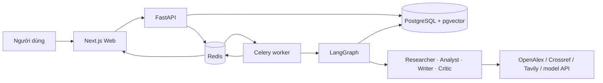

# Synthia

**Hệ thống web đa tác tử hỗ trợ nghiên cứu và soạn bản thảo bài báo có thể truy vết nguồn.** Người dùng đặt câu hỏi, cung cấp tài liệu hoặc dữ liệu, theo dõi từng bước và kiểm tra bản thảo trước khi sử dụng.

[](https://github.com/NguyenChien536/Multi-Agent-Research-System/actions/workflows/ci.yml?query=branch%3Amain) [](https://github.com/NguyenChien536/Multi-Agent-Research-System/actions/workflows/ci.yml?query=branch%3Adevelop)

> [!IMPORTANT]
> **Trạng thái:** bản phát hành **local qua Docker** để demo và đánh giá, chưa phải dịch vụ production công khai. CI kiểm tra code và runtime với provider giả; chất lượng bài báo và khả năng chạy với API thật cần được nghiệm thu riêng. Bản thảo không thay thế tác giả hoặc phản biện khoa học.

## Bắt đầu nhanh

**Cần:** Docker Desktop đang chạy Linux containers, PowerShell, Git. Để tạo bài thật, chuẩn bị API key cho một model chat tương thích hoặc cấu hình provider máy chủ; OpenAlex và Crossref có thể tìm metadata học thuật mà không cần key. API miễn phí vẫn có quota và giới hạn đầu ra.

```powershell
git clone https://github.com/NguyenChien536/Multi-Agent-Research-System.git
cd Multi-Agent-Research-System
.\scripts\release.ps1 -Action init      # máy mới: tạo secret riêng, chỉ chạy một lần
.\scripts\release.ps1 -Action deploy    # build image, migrate DB, khởi động và kiểm health
.\scripts\release.ps1 -Action status    # xem URL thực tế
```

Mặc định mở **http://127.0.0.1:3080**; máy demo đã cấu hình có thể dùng cổng khác (ví dụ 3082). `init` không ghi đè cấu hình cũ. Những lần mở sau dùng `.\scripts\release.ps1 -Action start` để chạy đúng image đã chốt, không build lại source. Dùng `-Action stop` để dừng mà vẫn giữ database, tài khoản và bài nghiên cứu. **Không dùng `docker compose down -v` trên dữ liệu demo.**

Sau khi mở web:

1. Đăng ký hoặc đăng nhập, vào **Settings → AI connection**, chọn dịch vụ, nhập API key, chọn model trong danh sách hoặc nhập **model ID đúng theo dịch vụ**, rồi lưu. Key được mã hóa ở backend và không hiện lại trên giao diện. Có thể dùng kết nối OpenAI-compatible khác ngoài OpenAI.
2. Chọn **New Research**, nhập câu hỏi, loại nghiên cứu và mức độ; tạo bài. Nếu bài cần tài liệu hoặc dữ liệu, tải PDF/CSV tại workspace theo hướng dẫn trên màn hình.
3. Theo dõi **Agent Monitor**; khi cần, duyệt kế hoạch hoặc bổ sung dữ liệu để tiếp tục. Bài đang chờ không chiếm worker, nên có thể tạo bài khác.
4. Đọc **Scientific Paper**, **Sources**, **Evidence & Citations** và **Experiments & Journal** (nếu có). Sửa hoặc kiểm chứng các kết luận trước khi tải Markdown, Word hoặc gói dữ liệu được hỗ trợ.

Kết nối cá nhân đã lưu được ưu tiên. Nếu người vận hành bật `USE_SERVER_PROVIDERS=true` trong env riêng, bài không có kết nối cá nhân mới dùng provider máy chủ. Đổi model không xóa token/chi phí đã tiêu của bài đang làm. Không đưa key vào issue, chat, ảnh chụp hoặc Git.

## Ba loại nghiên cứu

| Loại trên web | Khi nào dùng | Hệ thống tạo và giới hạn |
|---|---|---|
| **Tổng quan tài liệu** (`REVIEW`) | Tổng hợp nghiên cứu đã công bố cho một câu hỏi | Tìm, lưu và đối chiếu nguồn; viết bản thảo có cấu trúc, trích dẫn và điểm còn thiếu. Không tự nhận là systematic review hoặc chứng minh giả thuyết mới. |
| **Thực nghiệm tính toán** (`EMPIRICAL_COMPUTATIONAL`) | Có dữ liệu dạng bảng để chạy quy trình được hỗ trợ | Với routine `tabular_regression_v1`, lưu dữ liệu, baseline, chỉ số, hình và nhật ký thí nghiệm rồi viết bản thảo. Chưa chạy mã Python tùy ý do AI sinh. |
| **Nghiên cứu do con người thực hiện** (`EMPIRICAL_HUMAN`) | Cần khảo sát, lab hoặc thực địa | Đề xuất protocol rồi lưu trạng thái chờ. Người dùng thực hiện nghiên cứu bên ngoài, nạp kết quả và nguồn gốc dữ liệu để hệ thống tiếp tục. Hệ thống không tuyển người, xin phê duyệt đạo đức hoặc xác minh độc lập dữ liệu đã nạp. |

Xem [bộ dữ liệu và câu hỏi demo](examples/demo) để thử ba luồng. Dữ liệu demo là **tổng hợp/giả lập**, không phải kết quả nghiên cứu trên người thật. Một bản thảo có đủ đầu mục vẫn có thể ở trạng thái `NEEDS_REVIEW`; đây là tín hiệu cần kiểm tra, không phải bài đã được duyệt.

## Cách hệ thống hoạt động



FastAPI xác thực, kiểm quyền sở hữu và ghi task. Redis/Celery chạy công việc dài ngoài HTTP; LangGraph điều phối các vai trò. Supervisor lập kế hoạch, Researcher tìm nguồn, Evidence Analyst rút bằng chứng, Writer soạn bản thảo, Critic yêu cầu sửa hoặc đánh dấu vấn đề. Methodologist và Data Analyst chỉ tham gia khi loại nghiên cứu cần. Critic là **bước kiểm tra nội bộ**, không phải phản biện độc lập. PostgreSQL lưu trạng thái/checkpoint, nguồn, bằng chứng và phiên bản; giao diện hiển thị tiến độ từ sự kiện worker. Hệ thống có giới hạn lượt gọi, thời gian và ngân sách để tránh chạy không kiểm soát.

| Thư mục/file | Trách nhiệm chính |
|---|---|
| `backend/app/api/v1/endpoints/` | Auth, task, nguồn, báo cáo, Settings và tải tệp |
| `backend/app/agents/` | Graph, state và các vai trò nghiên cứu/viết/phản biện |
| `backend/app/services/`, `backend/app/tools/` | Budget, provider, search, bằng chứng, thí nghiệm, xuất bản |
| `backend/app/prompts/templates/` | Prompt theo vai trò, tách khỏi code xử lý |
| `backend/app/models/`, `backend/alembic/` | Dữ liệu và migration |
| `frontend/src/app/`, `frontend/src/components/` | Trang, workspace, monitor và UI dùng lại |
| `docker-compose.yml`, `scripts/` | Một Compose với hai profile `dev`/`prod`; lệnh vận hành và smoke test |
| `examples/demo/` | Input tổng hợp cho ba luồng demo |

Chi tiết quy ước nhánh, PR và điều kiện đưa code lên `main` ở [CONTRIBUTING.md](CONTRIBUTING.md). [SRS ATI.md](SRS%20ATI.md) là yêu cầu của đồ án.

## Phát triển và kiểm thử

Môi trường `dev` dùng database, Redis, secret và volume riêng; frontend/API tự reload. Môi trường `prod` là **bản demo local** dùng image đã build, không mount source. Hai môi trường dùng cùng `docker-compose.yml`.

```powershell
.\scripts\dev.ps1 -Action init       # một lần trên máy mới
.\scripts\dev.ps1 -Action start      # UI mặc định :3000, API docs :8000/api/v1/docs
.\scripts\dev.ps1 -Action status
.\scripts\dev.ps1 -Action stop

cd frontend
npm ci
npm test
npm run build
```

CI trên PR/push chạy cú pháp Python, migrate và toàn bộ backend tests với PostgreSQL/Redis **riêng cho test**, frontend tests/build, Compose build và smoke runtime không dùng provider trả phí. Xem [workflow CI](.github/workflows/ci.yml) và badge của đúng nhánh/commit. Không chạy backend tests trên database làm việc.

Khi provider thật đã cấu hình, có thể kiểm luồng API → worker → báo cáo lưu trong DB (lệnh này **có thể tiêu thụ quota/chi phí**):

```powershell
.\scripts\smoke-demo.ps1 -ApiBaseUrl http://127.0.0.1:3080/api/v1 -FrontendUrl http://127.0.0.1:3080
```

Thay `3080` bằng cổng mà `release.ps1 -Action status` in ra. Script kiểm có báo cáo được lưu, nhưng `PARTIAL`/`NEEDS_REVIEW` và một bài có văn bản vẫn **chưa** chứng minh chất lượng học thuật. Trước khi nộp, kiểm nguồn, luận điểm, số liệu/hình, giới hạn, giao diện và ba loại nghiên cứu bằng tay. `main` chỉ nhận thay đổi sau CI và kiểm demo end to end trên đúng revision.

## Vận hành và giới hạn

- `.\scripts\release.ps1 -Action logs` xem lỗi API/worker; trang **Agent Monitor** cho biết bước, sự kiện và hạn mức của từng bài. Khi lỗi provider, kiểm quota, model ID, khả năng xuất token và kết nối trước khi chạy tiếp từ checkpoint.
- `.\scripts\release.ps1 -Action backup` lưu database/artifact ngoài Git. `restore` chỉ vào project/cổng mới để không ghi đè bài demo; giữ nguyên `APP_SECRET_KEY` để đọc khóa đã mã hóa. Backup có thể chứa dữ liệu riêng tư.
- Phần tìm kiếm học thuật dùng OpenAlex/Crossref; Tavily bổ sung web search khi có key. Việc tìm được URL không chứng minh nguồn hỗ trợ một luận điểm. Citation và nội dung, đặc biệt với dữ liệu do người dùng cung cấp, vẫn cần người kiểm tra.
- Free tier của model có thể trả 429/503, timeout hoặc giới hạn đầu ra. Key hợp lệ không bảo đảm một bài chạy liền mạch. Giá hiển thị là **ước tính**, không phải hóa đơn. Nếu hết hạn mức nội bộ, xem phần tăng allowance/tiếp tục trong workspace; đổi model không tự cấp lại allowance.
- Không có dịch vụ HTTPS công khai, sandbox chạy code AI tùy ý, hay bảo đảm bài đạt chuẩn tạp chí/Q1. Các bài có can thiệp trên người cần tác giả tự thực hiện quy trình và tuân thủ yêu cầu đạo đức liên quan.

Khi đóng gói source để nộp, dùng Git hoặc `git archive`; không kèm `.env`, API key, database/volume, `storage/`, `scratch/`, `.venv/`, `node_modules/` hay bản sao lưu. Chỉ các file được Git theo dõi mới có trong gói `git archive`.
