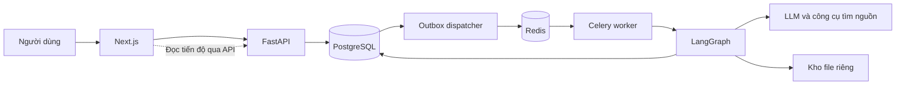

# Hiểu code và demo Synthia

Chuẩn bị ngày **04/11/2026** cho buổi demo **05/11/2026**. Tài liệu này gom cách hiểu code, thao tác demo và dữ liệu mẫu vào một chỗ. Các mô tả dưới đây được đối chiếu với source hiện tại; kết quả chạy offline được phân biệt với nghiệm thu web/provider thật.

## 1. Bắt đầu từ ý nghĩa của sản phẩm

**Synthia hỗ trợ biến câu hỏi nghiên cứu thành bản thảo bài báo có nguồn và bằng chứng.** Hệ thống chia công việc cho các vai trò agent: lập kế hoạch, thu thập tài liệu, phân tích bằng chứng, thiết kế phương pháp khi cần, viết và phản biện. Người nghiên cứu kiểm tra và chịu trách nhiệm trước khi sử dụng hoặc công bố.

Ba đường sử dụng khác nhau:

| Người dùng cần | Họ cung cấp | Hệ thống làm | Kết quả |
|---|---|---|---|
| Tổng quan tài liệu | Câu hỏi; có thể thêm PDF riêng | Tìm nguồn, trích bằng chứng, tổng hợp, viết và kiểm tra | Bản thảo tổng quan với citation, References, giới hạn |
| Thực nghiệm tính toán | Câu hỏi phù hợp và CSV số | Chạy routine hồi quy được hỗ trợ, so với baseline, lưu số liệu/biểu đồ/journal, viết bài | Bản thảo thực nghiệm và gói tái lập |
| Khảo sát/lab/thực địa | Câu hỏi; sau đó kết quả và nguồn gốc dữ liệu | Sinh protocol, lưu checkpoint và chờ; nhận dữ liệu để tiếp tục viết | Protocol trung gian; bản thảo sau khi có dữ liệu |

Không giới thiệu sản phẩm là công cụ tự làm mọi loại thí nghiệm, thay thế người nghiên cứu hoặc bảo đảm bài được nhận đăng. Bản demo tính toán hiện dùng `tabular_regression_v1`, không chạy tùy ý code do AI sinh.

## 2. Mở dự án bằng gì?

**Dùng VS Code để đọc code, xem diff, chạy terminal và diễn tập. Dùng Antigravity khi muốn Gemini sửa code.** Không cần chuyển hay sao chép dự án giữa hai IDE.

Mở đúng thư mục:

```text
C:\Users\CHIEN\OneDrive\Desktop\ATI\MultiAgent Research System
```

Hai IDE nhìn cùng các file. Không để hai công cụ cùng sửa một file. IDE chỉ là nơi soạn thảo: API, worker và database trong Docker vẫn chạy độc lập với cửa sổ IDE.

Không tạo repo/worktree mới chỉ để đổi IDE. Không dùng thư mục có hậu tố cũ nếu chưa xác minh nó thuộc nhánh nào.

## 3. Hiểu công nghệ bằng một lần bấm “Bắt đầu”

| Công nghệ | Hiểu đơn giản | Trong dự án |
|---|---|---|
| TypeScript + React + Next.js | Code giao diện chạy trên trình duyệt và framework web | Form tạo bài, dashboard, trang bài, monitor, hỏi đáp |
| Python + FastAPI | Backend nhận và trả dữ liệu qua HTTP | Xác thực, kiểm input/quyền, tạo task, upload, resume, tải kết quả |
| Pydantic | Kiểm tra cấu trúc dữ liệu | Không nhận thiếu trường, sai kiểu, sai giới hạn; kiểm output JSON của model |
| SQLAlchemy | Đọc/ghi database bằng Python | Task, nguồn, claim, report, phiên bản, experiment, journal |
| PostgreSQL | Bộ nhớ bền vững của hệ thống | Đóng ứng dụng/máy rồi mở lại vẫn còn bài và checkpoint nếu giữ volume |
| pgvector | Khả năng lưu và tìm vector trong PostgreSQL | Truy xuất các đoạn liên quan khi có embedding; còn có đường truy xuất từ khóa |
| Redis + Celery | Hàng đợi và tiến trình nhận việc nền | Web không phải giữ HTTP request suốt lúc nghiên cứu chạy |
| LangGraph | Đồ thị có trạng thái và điều kiện chuyển bước | Agent nào chạy trước, khi nào tìm thêm, sửa bài hoặc dừng chờ |
| LLM provider | Dịch vụ mô hình bên ngoài | Sinh kế hoạch, trích xuất, viết và phản biện; không phải database |
| Docker Compose | Chạy các dịch vụ cùng cấu hình | Gateway, web, API, worker, PostgreSQL, Redis |

Ví dụ luồng tạo bài:

1. **Next.js** đọc câu hỏi và cấu hình rồi gọi `POST /api/v1/research`.
2. **FastAPI** xác thực người dùng, kiểm dữ liệu, tạo bản ghi task trong **PostgreSQL**.
3. Khi bắt đầu, API ghi trạng thái `QUEUED` và một bản ghi yêu cầu gửi việc trong **cùng transaction**.
4. **Outbox dispatcher** đọc yêu cầu đã lưu và gửi job qua **Redis**.
5. **Celery worker** nhận job, claim task hợp lệ, chuyển `RUNNING` và gọi **LangGraph**.
6. Graph lần lượt chạy các vai trò, dùng tool và ghi kết quả. Budget được kiểm trước provider calls.
7. Web đọc trạng thái/monitor qua API để cập nhật màn hình. Bản hiện tại có polling; không giới thiệu SSE replay là đã hoàn thành chỉ vì diagram mục tiêu có SSE.
8. Sau khi xử lý, bản thảo và phiên bản được lưu; UI mở bài, nguồn, citation và các artifact được phép tải.



Mũi tên từ DB đến dispatcher có nghĩa dispatcher đọc bản ghi outbox; PostgreSQL không tự chạy dispatcher. File được tải qua API kiểm quyền, không mở thẳng toàn bộ kho file ra Internet.

## 4. Agent phối hợp thế nào?

| Bước | Đầu vào → đầu ra | Vì sao cần? |
|---|---|---|
| Supervisor | Câu hỏi → phạm vi, truy vấn, đề cương, nhu cầu bằng chứng | Tránh viết ngay khi chưa xác định cần nghiên cứu gì |
| Researcher | Truy vấn/thiếu sót → ứng viên nguồn và lịch sử tìm kiếm | Tìm tài liệu cho các mặt khác nhau của câu hỏi |
| Curator/tools | Nguồn → nội dung đã xử lý, chunks | Parse, lọc và chuẩn bị dữ liệu; đây có phần code deterministic, không phải mọi node đều là LLM agent |
| Evidence Analyst | Đoạn liên quan → claim và quote có nguồn | Giữ căn cứ cho Writer và các bước kiểm tra |
| Methodologist, nếu thực nghiệm | Bằng chứng và câu hỏi → protocol phù hợp phạm vi hỗ trợ | Không biến mọi bài thành review hoặc tự dựng thực nghiệm |
| Experiment runner, nếu tính toán | CSV → manifest, baseline/model metrics, chart data, repeatability | Số liệu do code chạy thật, không để LLM đoán |
| Writer | Đề cương, claim, dữ liệu/kết quả → bản thảo | Viết theo loại bài, dùng nguồn và số liệu được cung cấp |
| Critic | Bản thảo và evidence → đánh giá, yêu cầu sửa/tìm bổ sung | Một bước kiểm nội bộ, không phải peer review độc lập |
| PostProcessor/validators | Bản thảo → citation/reference, kiểm tra và định dạng | Kiểm tính hợp lệ; vẫn có thể trả `NEEDS_REVIEW` |

**Hai vòng cải thiện:** micro-loop quay từ Critic về Writer để sửa cách viết/lập luận; macro-loop quay về Researcher khi thiếu bằng chứng. Cả hai có giới hạn lượt, token, chi phí ước tính và thời gian. Hết giới hạn không được tự khẳng định đã đạt chất lượng.

**Chờ mà không giữ worker:** với khảo sát/lab, LangGraph lưu checkpoint, task chuyển `WAITING_USER_DATA`, job kết thúc. Người dùng mở bài khác bình thường. Khi upload/resume đúng bài, đúng plan version và đúng owner, một job mới tiếp tục checkpoint. A/B/C cùng chờ thì vẫn tạo D được; giới hạn hiện tại mặc định là 2 bài `RUNNING`/user, không phải chỉ được có 2 bài.

## 5. Đọc file nào trước và tìm code ở đâu?

Đọc theo thứ tự bảng, không đọc hết repo từ trên xuống. Với file lớn, tìm tên hàm bằng Ctrl+F/Ctrl+Shift+F.

| Thứ tự | File/thư mục | Tìm gì? |
|---|---|---|
| 1 | `frontend/src/app/page.tsx` | `handleStartResearch`: payload tạo bài, upload PDF và bắt đầu |
| 2 | `frontend/src/lib/api.ts` | `tasks.create`, `start`, `uploadDataset`, `resumeWithData`: đường gọi HTTP và auth |
| 3 | `backend/app/main.py`, `api/v1/api.py` | Khởi tạo FastAPI, middleware, đăng ký router/dispatcher |
| 4 | `backend/app/api/v1/endpoints/research.py` | `create_research_task`, `start_research_task`, upload và resume |
| 5 | `backend/app/services/task_dispatcher.py` | Outbox, retry và khôi phục job chưa được worker claim |
| 6 | `backend/app/worker.py` | `run_langgraph_workflow`: claim, lease, checkpoint, chạy graph, lưu kết quả/lỗi |
| 7 | `backend/app/agents/graph.py` | `build_research_graph`, `route_after_analyst`, `route_after_methodologist`, hai research loops |
| 8 | `backend/app/agents/state.py` | Các trường state đi qua graph; không lưu API key vào đây |
| 9 | `backend/app/agents/nodes.py` | `supervisor_node`, `analyst_node`, `writer_node`, `critic_node`, `experiment_runner_node` |
| 10 | `backend/app/tools/` | Search, scholarly search, safe fetch, chunk/embedding và retrieval |
| 11 | `backend/app/services/experiment_runner.py`, `isolated_experiment.py` | Routine cố định, metric, split, preprocessing và process thực thi |
| 12 | `backend/app/services/fieldwork_intake.py` | Kiểm file ngoài hệ thống, checksum, thống kê mô tả CSV |
| 13 | `backend/app/services/manuscript.py`, `academic_writing.py`, `scientific_paper.py` | Contract bài báo, mục con, giới hạn diễn giải, figure |
| 14 | `backend/app/services/provider_budget.py`, `model_connection.py` | Budget, kết nối API riêng và key mã hóa; BYOK đang chờ nghiệm thu |
| 15 | `backend/app/models/`, `schemas/`, `alembic/versions/` | Dữ liệu lưu, dữ liệu API nhận/trả, migration cấu trúc DB |
| 16 | `frontend/src/app/research/[id]/page.tsx`, trang `monitor/` | Hiển thị bài, chờ/nạp dữ liệu và quan sát tiến độ |
| 17 | `backend/tests/`, `frontend/tests/`, `.github/workflows/` | Bằng chứng kiểm thử và kiểm tra CI |

Trong Next.js, `[id]` nghĩa là đường dẫn có mã bài thay đổi, ví dụ `/research/<task-id>`. Trong FastAPI, `Depends(...)` cung cấp dependency như session DB và người dùng đã xác thực. `async/await` giúp chờ I/O mà không chiếm luồng xử lý theo kiểu đồng bộ; nó không thay thế worker hoặc queue.

## 6. Kiến trúc, pattern và clean code để giải thích với thầy

| Quyết định/pattern thực sự có | Vị trí | Câu giải thích ngắn |
|---|---|---|
| Modular monolith, API/worker là tiến trình riêng | `backend/app/`, Compose | Chia trách nhiệm theo module, dễ tích hợp cho quy mô đồ án; không tách mỗi agent thành microservice |
| State machine / graph orchestration | `agents/graph.py` | Điều kiện chuyển bước do code quyết định, có interrupt/resume và vòng lặp có giới hạn |
| Transactional outbox | Endpoint start, models task, dispatcher | Ghi task và ý định gửi job cùng transaction, sau đó retry gửi broker khi cần |
| Idempotent claim và worker lease | `worker.py`, dispatcher | Job có thể giao lặp; worker kiểm quyền thực thi và phiên chạy để tránh chạy trùng/ghi muộn |
| Dependency injection | `api/deps.py`, `Depends(get_db)` | Tập trung xác thực/session và thay thế dependency khi test |
| Provider factory/adapter | Factory trong `nodes.py`, `structured_output.py`, `model_connection.py` | Cùng luồng nghiệp vụ có thể dùng provider khác; output vẫn kiểm schema |
| Versioned snapshot/provenance | Report versions, experiment bundle, source/claim/citation | Theo dõi bài nào dựa trên dữ liệu và kết quả nào, giữ phiên bản trước khi sửa |
| Guard trước side effect/provider call | Budget, ownership, attempt/version checks | Không chỉ kiểm ở màn hình; backend chặn vượt quota, sai owner hoặc run cũ |

Không gọi code hiện tại là strict Clean Architecture, exactly-once execution hoặc sandbox an toàn cho mã tùy ý. Một số file như `nodes.py`, `worker.py` và trang workspace còn lớn; nên tách dần theo trách nhiệm sau khi có regression tests. Trước buổi demo, ưu tiên lỗi ảnh hưởng luồng chạy, dữ liệu, secrets và đầu ra; tránh refactor lớn chỉ để đổi tên/làm đẹp mà chưa chạy lại.

## 7. Bộ đầu vào dùng ngay

Trong `examples/demo/` có các câu hỏi để copy, hai dataset tính toán, một dataset khảo sát, form nhập và kết quả đối chiếu. Các CSV đều **synthetic**, được sinh xác định bởi `scripts/prepare-demo.py`. Không cần tuyển người hoặc tìm dữ liệu riêng để diễn tập phần upload/resume.

```powershell
# Chạy tại thư mục gốc. Không gọi LLM, search, DB hoặc dịch vụ trả phí.
.\.venv\Scripts\python.exe scripts/prepare-demo.py
```

Script chạy routine thật qua process riêng, chạy lại để kiểm repeatability và kiểm intake CSV khảo sát. `expected-checks.json` là kết quả offline; không phải bằng chứng rằng bài đã chạy qua web, được Writer viết hoặc đạt chuẩn khoa học. Không upload file expected-checks thay cho dataset để giả lập kết quả hệ thống.

### 7.1 Demo REVIEW — Giá trị của luyện tập giãn cách

**Câu hỏi:** copy `examples/demo/review-question.txt`. Chủ đề hỏi điều kiện luyện tập giãn cách giúp ghi nhớ dài hạn hơn luyện tập dồn ở người trưởng thành/sinh viên.

| Cấu hình | Giá trị |
|---|---|
| Loại | Tổng quan / `REVIEW` |
| Độ sâu | STANDARD |
| Độ dài | MEDIUM cho chạy thử; chỉ chọn LONG sau khi đã kiểm context/quota |
| Ngôn ngữ | English |
| Citation | APA |
| Duyệt kế hoạch | Bật để demo HITL |
| Nguồn tối đa | Bản candidate đã có trường 3–30 trong tùy chọn, mặc định 12; API payload cũng có `max_sources=12`. Đây là giới hạn thu thập, không phải cam kết bài sẽ trích đủ 12 nguồn |
| File bắt buộc | Không có. PDF riêng là tùy chọn |

**Thao tác:** đăng nhập → tạo bài → mở plan và duyệt → mở monitor, chỉ ra agent đang chạy → khi xong mở bài → xem mục con, nguồn, evidence/citation và References → chọn một citation để đối chiếu → xuất định dạng đang được UI hỗ trợ.

**Điểm cần xem trong đầu ra:** phạm vi tìm kiếm có thật; phân biệt retention interval và practice schedule; có tổng hợp theo chủ đề, giới hạn và nghiên cứu trái chiều nếu tìm được; kết luận không biến một hiệu ứng có điều kiện thành quy luật tuyệt đối. Không gọi là systematic review/PRISMA nếu thực tế chưa thực hiện đủ quy trình.

**Hỏi đáp:** “Which evidence supports the claim that retention interval affects the spacing benefit, and what limitations remain?” Nếu chưa có evidence tương ứng, câu trả lời đúng là thiếu bằng chứng, không phải tự tạo nguồn.

**Sửa bài:** “Revise the Discussion to distinguish findings in university learners from tentative transfer to other populations. Preserve citation identities and do not add unsupported facts.” Kiểm tra tạo phiên bản mới và vẫn mở được phiên bản cũ.

### 7.2 Demo COMPUTATIONAL — Dự đoán điện năng synthetic

**Câu hỏi:** copy `examples/demo/computational-question.txt`.

Chọn `EMPIRICAL_COMPUTATIONAL`, STANDARD, MEDIUM, English, IEEE; có thể tắt duyệt kế hoạch cho kịch bản này để tiết kiệm thời gian trình bày.

1. Tạo bài và mở workspace. Hệ thống lập phương pháp; nếu chưa có CSV sẽ dừng chờ.
2. Tải `examples/demo/computational-electricity-synthetic.csv` vào ô **dataset CSV tính toán**, không dùng ô upload PDF hoặc fieldwork.
3. Với task đang `WAITING_USER_DATA`, endpoint dataset hiện tự enqueue resume; không bấm Start lần hai để tạo lượt chạy mới.
4. Theo dõi runner/Writer/Critic trong monitor. Khi xong, xem kết quả thực nghiệm, bảng so sánh, hình và journal.
5. Mở bài, kiểm số liệu khớp experiment; tải gói tái lập nếu có trên UI.

CSV có 120 dòng: `temperature`, `occupied_hours` là features; cột cuối `target` là mục tiêu. Không thêm cột ID hoặc ngày dạng chữ vào routine này. Đây là hồi quy bảng với random split, không phải xác minh dự báo chuỗi thời gian ngoài đời.

**Kết quả offline từ routine hiện tại trên đúng CSV:**

| Chỉ số | Mean baseline | Ridge |
|---|---:|---:|
| MAE | 12.338741 | 1.335145 |
| RMSE | 14.210697 | 1.468646 |
| R² | -0.012568 | 0.989185 |

Seed 42; 96 train/24 test; alpha=1; standardization fit trên train. MAE/RMSE nhỏ hơn là tốt hơn; R² đo mức giải thích biến thiên so với dự đoán trung bình trên test, có thể âm. Chênh lệch MAE trong code là `model - baseline`, nên giá trị âm ở đây là giảm sai số. Kết quả tốt trên dữ liệu synthetic được dựng có quan hệ tuyến tính không chứng minh Ridge tốt cho mọi dữ liệu.

**Tính tái lập:** chỉ cùng dữ liệu/code/configuration cho kết quả khớp trong tolerance; chưa phải robustness qua nhiều seed hoặc generalization trên dữ liệu khác. Journal và ZIP phải thuộc đúng report version, giữ checksum, code/config và metrics.

**Kịch bản kết quả không cải thiện, tùy thời gian:** tạo một task tính toán khác, upload `computational-negative-control-synthetic.csv`. Hai features là hằng số nên không có thông tin dự báo; kiểm offline cho `NO_IMPROVEMENT`, delta MAE=0. Không sửa bài để biến kết quả này thành “model vượt baseline”. Đây là minh họa giữ kết quả không thuận lợi, không phải thí nghiệm khoa học diện rộng.

### 7.3 Demo HUMAN — Khảo sát mô phỏng về trợ lý AI

**Câu hỏi:** copy `examples/demo/human-question.txt`. Chọn `EMPIRICAL_HUMAN`, STANDARD, MEDIUM, English, APA; tắt duyệt kế hoạch nếu không muốn lặp lại phần HITL của REVIEW.

1. Tạo bài, mở protocol; giải thích nghiên cứu ngoài hệ thống cần thu thập thật nếu muốn có kết luận thực tế.
2. Khi task `WAITING_USER_DATA`, về dashboard rồi mở/tạo bài khác. Quay lại và chỉ ra bài chờ vẫn giữ plan/protocol. Không cần để task chạy nền suốt thời gian người dùng đi khảo sát.
3. Upload `examples/demo/human-survey-synthetic.csv` vào ô kết quả khảo sát/fieldwork.
4. Điền **sample size = 24**. Copy `method_notes`, `results_summary`, `data_provenance` từ `human-form-inputs.json` vào các ô tương ứng. Nếu UI tên khác, đối chiếu ý nghĩa trường; không dán cả JSON vào một ô.
5. Bấm tiếp tục. UI/API phải dùng `artifact_id` của file vừa upload và `plan_version` hiện tại; không nhập mã cố định từ task khác.
6. Xem Writer/Critic chạy, mở bài và kiểm nhãn synthetic cùng thống kê.

| Biến | Mean | Sample SD, ddof=1 | Tần số |
|---|---:|---:|---|
| Usefulness | 3.5 | 1.142080 | 2,3,4,5: mỗi mức 6 |
| Verification effort | 3.0 | 1.474420 | 1:5; 2:5; 3:4; 4:5; 5:5 |

Tổng tần số mỗi biến là 24. Cột `synthetic_response_id` chỉ là ID, không phải thang đo hoặc một kết quả nghiên cứu. Không gọi 24 dòng này là 24 người đã được tuyển. Không có p-value, kiểm định giả thuyết, quan hệ nhân quả hoặc phê duyệt đạo đức thật trong dữ liệu demo.

Đường human-led hiện hỗ trợ intake CSV/TXT và thống kê mô tả CSV; không tự phân tích mọi định dạng SPSS, ảnh thí nghiệm hoặc tự thực hiện lab. Cần kiểm bài không hứa những thao tác chưa chạy.

### 7.4 Nếu demo qua API thay vì UI

`examples/demo/task-payloads.json` chứa ba body tạo task, không có key/tài khoản. API docs trên bản release thường ở `http://127.0.0.1:3080/api/v1/docs`; xác minh URL thực tế trước khi diễn tập. Xác thực bằng tài khoản của bạn, không ghi token vào slide hoặc quay màn hình phần secrets.

| Bước | Endpoint |
|---|---|
| Tạo bài | `POST /api/v1/research` |
| Bắt đầu | `POST /api/v1/research/{id}/start` |
| Trạng thái / monitor | `GET /api/v1/research/{id}` / `GET /api/v1/research/{id}/monitor` |
| Plan / duyệt | `GET .../{id}/plan` / `POST .../{id}/plan/approve` với version hiện tại |
| Dataset tính toán | `POST .../{id}/dataset`, multipart file |
| Kết quả human-led | `POST .../{id}/data/files`, multipart file |
| Resume human-led | `POST .../{id}/data/resume`, bốn trường form + `plan_version`, `file_artifact_id` thật |
| Bài / nguồn / citation | `GET .../{id}/report`, `/sources`, `/citations` |
| Thí nghiệm / journal | `GET .../{id}/experiments`, `/journal` |

Không tái sử dụng task ID, artifact ID, token hoặc plan version từ máy khác. Không đưa API key vào `task-payloads.json` đã version control. API/model được lưu trong Settings; bài mới tự dùng mặc định, còn bài hiện tại có thể đổi kết nối khi đã dừng.

## 8. Chuẩn bị và diễn tập trong hôm nay

Mục tiêu là **bản Docker local ổn định để demo**, không đồng nhất với việc đã nghiệm thu production phục vụ người dùng công khai.

| Thứ tự | Việc phải xong | Bằng chứng |
|---|---|---|
| 1 | Gemini hoàn tất, dừng thay đổi để review một diff xác định | Branch/commit rõ; biết những file chưa commit |
| 2 | Audit secrets/ownership/budget/BYOK và chất lượng đầu ra | Lỗi nghiêm trọng đã sửa; test đúng tình huống |
| 3 | Regression backend, frontend tests/build, Compose build/config | Kết quả pass trên đúng source; không suy từ CI của commit cũ |
| 4 | Candidate Docker cùng phiên bản API/worker/FE | Health, migration, đăng nhập và thao tác web thực tế |
| 5 | Chạy ba bài, chờ kết quả và đọc từng đầu ra | Task ID, version, provider, cấu hình, thời gian và vấn đề còn lại |
| 6 | Kiểm export, hỏi/sửa bài, chờ/nạp/resume, một lỗi input | File mở được; lịch sử và dữ liệu không hỏng |
| 7 | Chốt bản demo và backup | Không đổi model/code hoặc nâng dependency ngay trước trình bày |

**Lệnh quan sát** tại thư mục gốc, sau khi Docker Desktop đã chạy:

```powershell
docker info --format '{{.ServerVersion}}'
.\scripts\release.ps1 -Action status
```

`release.ps1 -Action start` sẽ build/migrate/start từ source hiện tại. Chỉ chạy sau khi source đã chốt và kiểm tra; không dùng nó để vô tình thay bản release đang ổn bằng code Gemini còn sửa. Không chạy `init` lên cấu hình đã có hoặc `down -v`, không thay APP_SECRET_KEY sau khi đã lưu key mã hóa.

**Trước khi demo:** tạo sẵn kết quả của ba bài trên đúng candidate, ghi lại các URL/task ID riêng trong ghi chú không chứa secrets; backup DB và artifact. Khi trình bày, vừa cho thấy một thao tác thật vừa mở kết quả đã hoàn tất để không phụ thuộc thời gian model. Nói rõ bài đã chạy trước, không trình bày như kết quả vừa được tạo tức thì.

**Kịch bản 10–12 phút:** 1 phút vấn đề/đầu ra → 2 phút kiến trúc/agent loop → 2 phút REVIEW/citation → 3 phút tính toán/metrics/figure/journal → 2 phút HUMAN chờ/resume → 1–2 phút giới hạn và hướng phát triển. Có thể demo bước chờ bằng một task đã chuẩn bị thay vì đợi provider ngay trên lớp.

## 9. Câu hỏi thầy dễ hỏi

| Câu hỏi | Trả lời có căn cứ |
|---|---|
| Vì sao không chỉ dùng một chatbot? | Có phân vai, state chung, evidence lineage, tool/runner và vòng sửa có kiểm soát. Hiệu quả hơn single-agent cần đánh giá cùng model/nguồn/ngân sách; chưa có kết quả thì không khẳng định vượt trội |
| AI có tự tạo số liệu không? | Số liệu tính toán lấy từ routine/CSV thật đã chạy; human-led là dữ liệu người dùng cung cấp, có nguồn gốc và mức xác minh riêng. Demo này dùng synthetic được gắn nhãn |
| Agent là những microservice riêng? | Không. Các role/node nằm trong graph chạy ở worker; API và worker là deployment processes riêng của modular monolith |
| Server chết lúc đang chờ khảo sát thì sao? | Plan/checkpoint lưu PostgreSQL; mở lại vẫn có trạng thái nếu DB/artifact volume còn. Resume kiểm owner/version; phục hồi giữa một provider call không có exactly-once guarantee |
| Hai lần bấm Start hoặc queue giao trùng? | Kiểm status, transaction/outbox và worker claim/attempt/lease; provider calls vẫn có giới hạn bảo đảm thực tế, không hứa exactly-once toàn hệ thống |
| Tại sao có baseline? | Nếu không so với cách đơn giản thì khó biết model thêm giá trị gì. Ở routine này baseline dự đoán trung bình của train |
| Reproducibility có nghĩa kết quả đúng? | Không. Cùng code/data/config chạy lại khớp là một điều kiện kiểm tra; không chứng minh thiết kế đúng hoặc kết quả tổng quát |
| Critic/citation validator loại hết hallucination? | Không. Validator kiểm tham chiếu và một số quy tắc, Critic là review nội bộ; vẫn cần kiểm hỗ trợ ngữ nghĩa và con người rà soát |
| Bài `NEEDS_REVIEW` có phải hệ thống hỏng? | Không nhất thiết. Có thể đã lưu được bản thảo nhưng còn vấn đề evidence, cấu trúc hoặc hết budget. Phải đọc lý do; không đổi nhãn để che lỗi |
| Làm sạch code đến đâu? | Có phân chia router/schema/service/model/tool và tests; vài module còn lớn. Giải thích cấu trúc thật và nợ kỹ thuật, không tự nhận tuân thủ kiến trúc tuyệt đối |
| Free API sao vẫn có USD? | USD có thể là dự toán theo đơn giá cấu hình, không phải hóa đơn. Phải phân biệt miễn phí đã xác minh, giá khai báo và giá chưa biết; không tự fallback sang model trả phí |

## 10. Trạng thái kiểm tra của bộ demo

- Đã tạo dữ liệu/câu hỏi/form cho cả ba loại.
- Đã thực thi routine qua process riêng trên hai CSV và kiểm repeatability offline: pass.
- Đã kiểm intake/thống kê CSV khảo sát: pass.
- Docker Engine đã kết nối lại; bộ `test_model_connection.py` và `test_structured_output.py` chạy trong container với database test riêng: **22 passed**. Đây là kiểm tra tập trung của source đang làm, không phải full regression hoặc nghiệm thu cuối cùng sau khi Gemini hoàn tất.
- Audit tiếp theo ngày 04/11: full backend **681 passed, 3 skipped**; sau các chỉnh sửa cuối, nhóm API key/budget/structured output/hỏi đáp **54 passed**; frontend **31 passed**. Backend/frontend Docker production builds đạt. Candidate mới ở cổng **3082**, web/API healthy; API auth và tạo/đọc/thu hồi key/xóa task cho cả ba loại đã kiểm qua gateway, không gọi provider. Bản release cổng 3080 vẫn là bản riêng.
- Chưa dùng các fixture mới này để tuyên bố UI/API/provider E2E trên bản Gemini đang sửa đã đạt.
- Chưa có kết luận chất lượng bài báo mới sau sửa, chưa xác minh mọi model miễn phí, chưa chốt production hoặc merge main.

Không xem kết quả offline là nghiệm thu thay cho các mục 2–6 ở bảng công việc hôm nay. Khi Gemini hoàn tất, review diff và kiểm trên đúng candidate rồi mới cập nhật kết luận.
