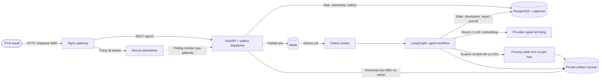

# Bản Docker dùng để demo cuối kỳ

## 1. Phạm vi và cách chạy

Bản release chạy trên **máy hiện tại**, truy cập tại **http://127.0.0.1:3080**. Đây là cấu hình triển khai local: không bật reload, không mount mã nguồn, không mở cổng PostgreSQL/Redis ra máy chủ. Bản này có database, Redis và kho file riêng với môi trường phát triển ở cổng 3000/8000; các bài cũ ở môi trường phát triển không tự xuất hiện trong release.

Mở PowerShell tại thư mục gốc dự án, bật Docker Desktop rồi chạy:

```powershell
# Chỉ chạy một lần; tạo secret riêng và sao chép cấu hình provider từ .env trên máy.
.\scripts\release.ps1 -Action init

# Build, migration, đợi các service healthy.
.\scripts\release.ps1 -Action start
.\scripts\release.ps1 -Action status

# Dừng và giữ toàn bộ dữ liệu.
.\scripts\release.ps1 -Action stop
```

Không đưa `scratch/release-local/.env`, tài khoản demo, bản thảo riêng hoặc bản backup lên GitHub. `init` không thay secret đã có; thay secret sau khi đã dùng sẽ làm phiên đăng nhập cũ hết hiệu lực. Provider vẫn cần Internet và quota/API key hợp lệ; Docker không thay thế nhà cung cấp mô hình/tìm kiếm.

## 2. Kiến trúc thực sự chạy trong bản release



Đây là **modular monolith** với API và worker triển khai thành hai tiến trình từ cùng một backend image. Mỗi agent là một vai trò trong graph, không phải một microservice. LangGraph là thư viện chạy trong worker. PostgreSQL giữ trạng thái bền vững; Redis chuyển job và có thể giao lặp, nên worker dùng claim/lease và kiểm phiên bản. Transactional outbox tránh mất yêu cầu giữa bước ghi database và gửi broker; không hứa exactly-once cho lời gọi provider.

Monitor hiện dùng **polling endpoint đã xác thực** để đọc snapshot, agent runs, thời gian, token/chi phí và lỗi. Cấu hình gateway không buffer luồng API để có thể hỗ trợ streaming; điều đó không có nghĩa bản hiện tại đã triển khai SSE replay.

`WAITING_USER_DATA`/chờ duyệt được lưu bằng checkpoint; worker kết thúc job và trả tài nguyên. Người dùng có thể mở nhiều bài khác trong khi chờ. Mỗi bài chỉ có một active run; quota giới hạn số bài chạy đồng thời. Upload/resume phải khớp owner, plan và checkpoint.

## 3. Chức năng, công nghệ và giới hạn để giải thích khi demo

| Nội dung | Cách thực hiện | Giới hạn phải nói rõ |
|---|---|---|
| Tổng quan tài liệu | Search + thu thập/parse + retrieval + Evidence Analyst + Writer/Critic + citation validation | Không bảo đảm tìm hết tài liệu hoặc trở thành systematic review chỉ nhờ tên mục |
| Tìm nguồn học thuật | Tavily, OpenAlex/Crossref và URL truy cập được | Một landing page/abstract không tương đương toàn văn; có thể bị rate limit/paywall |
| Thực nghiệm tính toán | Upload CSV numeric, routine `tabular_regression_v1`, baseline/Ridge, metric/figure, journal và gói tái lập | Chỉ routine được hỗ trợ; chưa chạy tùy ý code do LLM sinh. Process bị giới hạn không được giới thiệu là sandbox cho mã không tin cậy |
| Nghiên cứu ngoài hệ thống | Sinh protocol, dừng chờ, nạp kết quả có provenance rồi tiếp tục viết | Người nghiên cứu chịu trách nhiệm thu thập, đồng thuận/phê duyệt nếu cần; hệ thống không tự nhận đã làm khảo sát/lab |
| Bản thảo và xuất bài | Markdown, Word, in PDF bằng trình duyệt; ZIP nguồn LaTeX IEEE/ACM gắn report version | ZIP là nguồn cần người dùng kiểm tra/biên dịch; Word hiện không nhúng mọi figure. Không tự tạo tác giả, DOI hoặc trạng thái xuất bản |
| Theo dõi và truy nguyên | Monitor, agent runs, version báo cáo, citation/evidence lineage, experiment journal | Lineage đúng không tự chứng minh nội dung khoa học đúng; Critic không phải peer review độc lập |

Thiết kế dùng các module riêng cho budget/provider, evidence, manuscript, export và storage. API kiểm quyền sở hữu trước khi truy cập tài nguyên; bản download không mở trực tiếp thư mục artifact qua gateway. Dependency Python/Node được khóa; image ứng dụng chạy non-root, filesystem chỉ đọc, chỉ volume artifact và `/tmp` được ghi. Migration chạy thành job riêng trước API/worker.

## 4. Kiểm tra và phân biệt hai loại kết quả

```powershell
# Không gọi provider, kiểm tra web/API, login, ownership, tạo 3 loại bài và monitor.
.\.venv\Scripts\python.exe scripts/release-smoke.py

# Có gọi provider thật: chỉ một bài, cap 0.50 USD, 25 LLM calls, timeout 900 giây.
.\.venv\Scripts\python.exe scripts/release-smoke.py --generate REVIEW --output scratch/release-local/review
```

Lệnh Python dùng thư viện chuẩn; có thể dùng Python 3.11+ thay đường dẫn `.venv`. Các file kết quả/tài khoản nằm trong thư mục output riêng tư. Không chạy lại chiến dịch provider nhiều lần chỉ để tìm ra một kết quả đẹp.

**Runtime pass:** job được nhận, thực thi, lưu output/checkpoint đúng, monitor và export truy cập được. **Scientific quality:** đánh giá bố cục, nguồn, mức hỗ trợ của luận điểm, phương pháp và kết quả thực. `PARTIAL`/`NEEDS_REVIEW` là kết quả cần sửa, không được đổi tên thành bài hoàn tất chỉ để demo. Bản thảo `COMPLETED` vẫn cần người nghiên cứu kiểm chứng trước sử dụng học thuật.

CI kiểm backend, frontend, quy tắc nhánh và build dev; job `Release runtime` còn dựng release từ database sạch, chạy smoke không tốn provider và thử broker mất/kết nối lại. Real-provider/browser và backup/restore là các gate local riêng, không được suy ra từ test mock.

## 5. Theo dõi lỗi, sao lưu và khôi phục

```powershell
.\scripts\release.ps1 -Action logs
.\scripts\release.ps1 -Action backup

# Dùng đường dẫn backup vừa tạo; chỉ cho phép khôi phục sang project MỚI.
.\scripts\release.ps1 -Action restore -Project synthia-restore-check -Port 3081 -BackupPath '<duong-dan-backup>'
.\scripts\release.ps1 -Action status -Project synthia-restore-check -Port 3081
.\scripts\release.ps1 -Action stop -Project synthia-restore-check -Port 3081
```

Backup tạm dừng API ingress, từ chối nếu có bài QUEUED/RUNNING rồi dừng worker, lưu PostgreSQL và artifact cùng manifest/checksum. Redis không phải bản sao trạng thái nghiên cứu; bản restore chỉ dành cho snapshot không có job đang chạy. Script không xóa volume và không cho restore đè project demo chính. Kiểm tra dữ liệu/bản thảo/download trên project phục hồi trước khi coi backup là đã nghiệm thu.

Khi gặp lỗi, lưu task ID, thời gian, revision và monitor; xem log backend/worker. Không sửa database để ép trạng thái COMPLETED. Khi provider hết quota, sửa cấu hình provider rồi thực hiện retry có chủ đích; giữ bản ghi lỗi/kết quả âm. Không chia sẻ log chứa nội dung nghiên cứu riêng tư.

## 6. Gate trước khi đưa bản candidate lên main

1. CI của đúng revision pass, build image release thành công.
2. Fresh install, readiness và worker health pass; kiểm tra host chỉ mở cổng release trên loopback.
3. Luồng thực với provider và giao diện hoạt động; nội dung/kết quả chưa đạt phải ghi rõ, không che trạng thái.
4. Các nhánh review, computational và human-led có bằng chứng chạy hoặc checkpoint phù hợp; download theo đúng phiên bản và owner.
5. Restart giữ tài khoản/bài/file; backup/restore được thử trên project riêng.
6. Review diff và rủi ro còn lại; chỉ merge `develop → main` sau các gate trên. Chưa có đánh giá đủ mạnh thì không tuyên bố multi-agent tốt hơn baseline hay đủ an toàn để mở public Internet.
